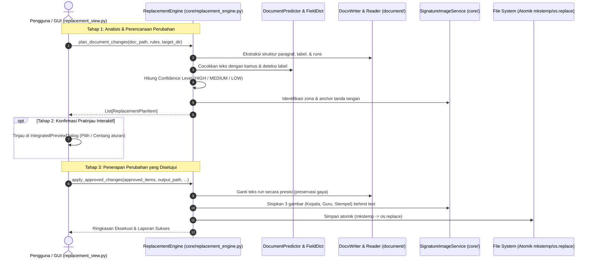

# 🤖 AI Agent Engineering Guidelines & Project Knowledge
**Repository:** `Smart RPP Replacer & Word to PDF Converter` (`giehotz/Documen-Replacer`)  
**Target Audience:** Autonomous and human-in-the-loop AI Agents (Claude Code, Cursor Agent, OpenAI Codex, ChatGPT, Copilot, Antigravity, etc.)  
**Version:** 2.0 (Multi-Image Signatures, Canvas Drag-and-Drop, Field Dictionary & PDF Conversion)

---

## 1. Executive Summary & Mission
Aplikasi desktop berbasis Python (Tkinter GUI) yang dirancang khusus untuk memproses, mengganti identitas data, menyisipkan tanda tangan/stempel digital, dan mengonversi berkas perangkat ajar/administrasi pendidikan (`.docx` dan `.doc` lama) secara massal (*batch processing*).

### Inti Kemampuan Sistem:
1. **Multi-layer Text Replacement Engine**: Penggantian teks cerdas berlapis (Exact Match, Regex, Similarity/Fuzzy Match, Placeholder Detection, Label Recognizer, dan Kamus Lengkap/Field Dictionary) dengan menjaga keutuhan format dokumen (font, bold, italic, color).
2. **3-Image Signature & Stamp Engine**: Penempatan 3 gambar terpisah (Tanda Tangan Kepala, Tanda Tangan Guru, dan Stempel Resmi Sekolah/Madrasah) langsung di belakang teks (*behind text*) pada dokumen Word dengan profil orientasi terpisah (*Portrait* & *Landscape*), didukung fitur *canvas drag-and-drop* interaktif.
3. **Smart Document Predictor**: Analisis sampel dokumen untuk mendeteksi label entitas secara otomatis dan memprediksi tata letak tanda tangan.
4. **Transparent Legacy `.doc` Compatibility**: Konversi otomatis berkas `.doc` biner lama ke `.docx` menggunakan Word COM (Windows) atau LibreOffice headless fallback.
5. **Batch Word to PDF Converter**: Antrean konversi massal Word ke PDF mandiri dengan *worker thread*, *cancellation*, dan opsi *auto-export*.

---

## 2. Directory Blueprint & Module Responsibilities

```
d:\docomen_replacer\
├── core/                       # Inti Logika Bisnis (Pure Python, headless, no GUI dependencies)
│   ├── __init__.py
│   ├── exact_matcher.py        # Lapis 1: Pencocokan string persis berbasis regex terkompilasi
│   ├── regex_replacer.py       # Lapis 2: Penggantian pola fleksibel berbobot
│   ├── similarity_matcher.py   # Lapis 3: Pencocokan kemiripan string (difflib)
│   ├── placeholder_detector.py # Lapis 4: Deteksi titik-titik (....) dan garis bawah (____)
│   ├── label_recognizer.py     # Lapis 5: Pengenalan label konteks (Kepala, NIP, Guru, Madrasah)
│   ├── field_dictionary.py     # Lapis 6: Kamus istilah terstruktur, alias, & never-match rules
│   ├── document_predictor.py   # Analisis dokumen sampel & auto-fill aturan penggantian
│   ├── doc_compat_service.py   # Kompatibilitas berkas .doc lama (COM / LibreOffice)
│   ├── signature_analyzer.py   # Deteksi zona tanda tangan (tabel 1 kolom/2 kolom, baris nama)
│   ├── signature_image_service.py # Penempatan XML gambar w:drawing behind text (3 gambar)
│   ├── validation_engine.py    # Perhitungan confidence score (HIGH/MEDIUM/LOW) & validasi
│   ├── replacement_engine.py   # Orkestrator utama alur: plan_document_changes & apply_approved_changes
│   ├── change_verifier.py      # Verifikasi mekanis/semantik & generator laporan perubahan JSON
│   └── pdf_converter/          # Subpaket Konversi Dokumen Word ke PDF
│       ├── __init__.py         # Ekspor ConversionManager, ConversionStatus, dll.
│       ├── base.py             # BaseConverter interface & kelas data opsi konversi
│       ├── conversion_manager.py # Manajer batch antrean konversi & multi-thread worker
│       ├── libreoffice_engine.py # Engine konversi fallback LibreOffice headless
│       └── word_com_engine.py  # Engine konversi utama MS Word COM (win32com)
│
├── document/                   # Manipulasi Dokumen Word Tingkat Rendah (python-docx & XML)
│   ├── __init__.py
│   ├── docx_reader.py          # Ekstraksi teks paragraf, tabel berulang, header, & footer
│   ├── docx_writer.py          # Run-level text replacement & preservasi drawing/formatting
│   ├── header_footer_processor.py # Penelusuran & penggantian teks header/footer tiap seksi
│   ├── paragraph_processor.py  # Penggantian teks run-level pada paragraf & proteksi drawing
│   └── table_processor.py      # Penggantian teks run-level di dalam sel-sel tabel dokumen
│
├── gui/                        # Antarmuka Pengguna Desktop (Tkinter + ttk)
│   ├── __init__.py
│   ├── app.py                  # Jendela utama (SmartRPPReplacerApp) & manajemen tab/thread
│   ├── replacement_view.py     # Tab 1: Form aturan penggantian, kontrol folder, & eksekusi
│   ├── signature_designer_dialog.py # Dialog preview TTD, drag-and-drop canvas, & 3 slider gambar
│   ├── preview_view.py         # Dialog pratinjau perubahan bertingkat sebelum diterapkan
│   ├── pdf_converter_view.py   # Tab 2: Antrean konversi Word ke PDF massal
│   ├── dictionary_dialog.py    # Dialog pengelola kamus istilah & kata tak dikenal
│   └── report_view.py          # Dialog ringkasan eksekutif pasca pemrosesan
│
├── services/                   # Layanan Pendukung
│   ├── __init__.py
│   └── report_service.py       # Generator laporan teks atomik ringkas pasca eksekusi
│
├── config/                     # Skema Konfigurasi & Kamus Bawaan
│   ├── dictionary.default.json # Kamus label standar terintegrasi (sekolah/madrasah)
│   ├── aliases.json            # Pemetaan alias kolom data
│   ├── signature_settings.example.json # Contoh format koordinat tanda tangan
│   ├── preset_example.json     # Contoh preset aturan penggantian teks
│   └── dictionary.user.example.json # Contoh kamus kustom pengguna
│
├── signatures/                 # Pustaka Gambar Tanda Tangan & Stempel Pengguna
│   └── .gitkeep                # Hanya .gitkeep yang di-commit (gambar dilindungi .gitignore)
│
├── tests/                      # Suite Pengujian Otomatis (98 Tests Wajib Lulus)
│   ├── __init__.py
│   ├── generate_samples.py     # Generator dokumen sampel uji .docx
│   ├── test_smart_engine.py    # Uji coba end-to-end engine penggantian teks (25 test)
│   ├── test_year_replacement.py # Uji coba 7 kasus golden test pola tahun (7 test)
│   ├── test_overlapping_proposals.py # Uji resolusi konflik usulan tumpang tindih (2 test)
│   ├── test_change_verifier.py # Uji verifikasi mekanis/semantik & laporan JSON (4 test)
│   ├── test_modul_ajar_context.py # Uji coba tabel identitas multi-paragraf Modul Ajar (3 test)
│   ├── test_anti_blind_replacement.py # Uji proteksi anti-blind replacement & isolasi placeholder (3 test)
│   ├── test_field_dictionary.py # Uji coba kamus istilah & normalisasi label (13 test)
│   ├── test_dictionary_corpus.py # Uji akurasi deteksi kamus terhadap korpus nyata (13 test)
│   ├── test_document_predictor.py # Uji coba prediksi field & auto-fill aturan (7 test)
│   ├── test_doc_compat.py      # Uji coba kompatibilitas .doc & fallback LibreOffice (5 test)
│   ├── test_pdf_converter.py   # Uji coba konverter PDF hermetis Word COM & LibreOffice (7 test)
│   ├── test_signature_library.py # Uji coba pustaka tanda tangan & stempel terpisah (6 test)
│   ├── test_signature_multi_image.py # Uji coba penyisipan 3 gambar ke XML Word (6 test)
│   └── test_signature_prediction.py # Uji deteksi orientasi & prediksi koordinat TTD (5 test)
│
├── utils/                      # Utilitas Lintas Platform
│   ├── __init__.py
│   └── platform.py             # Deteksi OS, ketersediaan MS Word COM, LibreOffice path
│
├── docs/                       # Dokumentasi Internal & Spesifikasi (diabaikan .gitignore)
│   ├── DESAIN_GUI_REDESIGN.md  # Blueprint spesifikasi desain ulang antarmuka dashboard
│   ├── RANCANGAN_OUTPUT_LAPORAN_PERUBAHAN.md # Spesifikasi laporan perubahan & perbaikan bug
│   └── REVIEW*.md              # Catatan audit arsitektur kode, kepatuhan PII, & mitigasi bug
│
├── README/                     # PANDUAN INI (Untuk AI Agent)
│   └── readmeAI.md             # Standard Operating Procedure & Knowledge Base AI
│
├── README.md                   # Dokumentasi publik repositori untuk pengguna umum
├── PANDUAN_PENGGUNAAN.md       # Panduan operasional non-teknis (diabaikan .gitignore)
├── LICENSE                     # Lisensi proyek (MIT License)
├── .gitattributes              # Normalisasi line-ending git (CRLF/LF)
├── .gitignore                  # Aturan proteksi PII & pengabaian artefak
├── requirements.txt            # Dependensi Python minimal (python-docx, Pillow, pywin32)
├── Jalankan_Smart_RPP_Replacer.bat # Launcher cepat Windows
└── main.py                     # Entry point eksekusi aplikasi
```

---

## 3. Strict Non-Negotiable Rules & Invariants (DO'S & DON'TS)

Setiap agen AI yang bekerja di repositori ini **WAJIB** mematuhi aturan ketat berikut tanpa pengecualian:

### 3.1 🛡️ Proteksi Data Pribadi (PII Protection) — HIGHEST PRIORITY
* **DILARANG KERAS** memasukkan, menulis, atau meng-commit nama orang nyata, NIP asli guru/kepala, nomor telepon, alamat instansi asli, atau berkas tanda tangan/stempel asli ke dalam repositori atau pesan commit.
* **Selalu gunakan data fiktif** untuk keperluan pengujian, contoh, dan dokumentasi:
  * Nama Kepala: `Budi Santoso, M.Pd`
  * NIP Kepala: `198001012005011001`
  * Nama Guru: `Siti Aminah, S.Pd`
  * NIP Guru: `198502022010012002`
  * Instansi: `Madrasah Ibtidaiyah Negeri 1 Contoh`
* File di `signatures/` dan `config/*.json` (kecuali berkas `*.example.json` dan `dictionary.default.json`) diabaikan oleh git. **Jangan pernah memaksa (`git add -f`) file konfigurasi user atau file gambar tanda tangan**.

### 3.2 📄 Integritas Run & Format Dokumen Word (`python-docx`)
* **JANGAN PERNAH** melakukan penggantian teks secara langsung pada level paragraf menggunakan:
  ```python
  # ❌ SALAH BESAR: Menghancurkan format run, font, bold, italic, dan elemen drawing!
  paragraph.text = paragraph.text.replace(old_text, new_text)
  ```
* **Wajib gunakan `core/replacement_engine.py` dan `document/docx_writer.py`**:
  * Penggantian dilakukan pada tingkat `Run` secara bedah.
  * Tag gambar (`w:drawing`), shape (`w:pict`), hyperlink, dan penanda bookmark (`w:bookmarkStart`) harus diproteksi agar tidak terhapus saat teks diganti.

### 3.3 🖼️ Geometri & Penempatan 3 Gambar Tanda Tangan & Stempel
* Sistem mendukung **3 entitas gambar mandiri**:
  1. `kepala`: Tanda tangan Kepala Madrasah / Sekolah.
  2. `guru`: Tanda tangan Guru Kelas / Mata Pelajaran.
  3. `stempel`: Cap stempel resmi sekolah/madrasah (posisi offset & lebar terpisah).
* **Konversi Satuan**:
  * Lebar diukur dalam centimeter: $1\text{ cm} = 360,000\text{ EMU} = 28.3465\text{ pt}$.
  * Offset X dan Y diukur dalam centimeter terhadap posisi anchor nama.
* **Behind Text XML**: Gambar disisipkan sebagai floating drawing menggunakan elemen `wp:anchor` dengan flag `<wp:behindDoc/>` aktif agar teks nama dan NIP tetap terbaca di atas gambar.
* **Dual Profiles**: Wajib selalu menangani perbedaan profil orientasi dokumen:
  * `portrait`: untuk dokumen tegak (default RPP / Modul Ajar).
  * `landscape`: untuk dokumen mendatar (biasanya Promes, Prota, atau Pemetaan KD).

### 3.4 🔒 Operasi Berkas Atomik & Exception Handling
* Penyimpanan dokumen Word yang telah diedit **wajib menggunakan penyimpanan atomik**:
  Tulis ke file sementara dengan `tempfile.mkstemp(dir=..., suffix=".tmp.docx")`, lalu gunakan `os.replace` untuk menimpa file target. Hal ini mencegah kerusakan dokumen asli jika proses terhenti di tengah jalan.
* **Dilarang menelan error**: Hindari konstruksi `except Exception: pass`. Jika ada operasi yang gagal, tangkap exception spesifik, catat ke log atau kembalikan status error dengan pesan deskriptif.

### 3.5 🧪 Protokol Pengujian & Regresi (Testing Protocol)
* **Perintah Uji Standar**:
  ```bash
  python -m unittest discover tests
  ```
* **JANGAN** menggunakan perintah `pytest` secara langsung di shell tanpa memastikan lingkungan virtual terpasang, karena lingkungan host mungkin hanya memiliki pustaka standar Python.
* **Invarian Uji**: Seluruh **98 test** harus berstatus **OK (100% Pass)** sebelum perubahan dianggap selesai.

---

## 4. Architectural Workflows & Data Flow

### 4.1 Siklus Hidup Penggantian Dokumen (Plan → Preview → Apply)


*(Catatan: Untuk eksekusi langsung satu langkah tanpa pratinjau, tersedia metode `process_file(input_path, output_path, rules, ...)`)*.

### 4.2 Alur Kamus Istilah (Field Dictionary Schema v2)
* Konfigurasi bawaan: [config/dictionary.default.json](file:///d:/docomen_replacer/config/dictionary.default.json).
* Aturan `never_match`: Label yang dilarang keras dicocokkan (misal "tanggal" tidak boleh tertukar dengan "nip").
* Normalisasi: Otomatis memetakan variasi penulisan seperti `Kepala Madrasah`, `Kamad`, `Kepala Sekolah`, `Kepsek` ke satu kategori kunci identitas yang konsisten.

---

## 5. Panduan Modifikasi Komponen (How-To Guides)

### A. Jika Ingin Menambah Lapis Deteksi Penggantian Baru
1. Buat modul pemroses baru di dalam folder [core/](file:///d:/docomen_replacer/core/).
2. Pastikan fungsi mengembalikan tuple `(status_cocok, teks_hasil, confidence_score)`.
3. Daftarkan pemanggilannya pada metode `plan_document_changes` di [core/replacement_engine.py](file:///d:/docomen_replacer/core/replacement_engine.py).
4. Buat file uji coba di `tests/test_<nama_fitur>.py` dengan skenario *true positive* dan *false positive*.

### B. Jika Ingin Memodifikasi Antarmuka GUI
* Aplikasi menggunakan **Tkinter standard library** dengan tema `ttk` agar dapat berjalan langsung di Windows tanpa instalasi library GUI eksternal yang rumit.
* Pastikan operasi berkas berat atau pemrosesan batch dokumen dijalankan di dalam **`threading.Thread(daemon=True)`** dan komunikasikan pembaruan UI melalui `queue.Queue` atau `widget.after()`, agar GUI tidak mengalami *freeze* (*Not Responding*).

### C. Jika Ingin Menambah Aturan Tanda Tangan
* Baca definisi geometri di [core/signature_image_service.py](file:///d:/docomen_replacer/core/signature_image_service.py).
* Pengaturan parameter tanda tangan dan stempel disimpan di kamus konfigurasi `DEFAULT_SETTINGS` dengan kunci terstruktur berikut:
  * **Kepala**: `enabled_kepala`, `kepala_image_path`, `kepala_name`, `kepala_width_cm`, `offset_x_kepala_cm`, `offset_y_kepala_cm`
  * **Guru**: `enabled_guru`, `guru_image_path`, `guru_name`, `guru_width_cm`, `offset_x_guru_cm`, `offset_y_guru_cm`
  * **Stempel**: `enabled_stempel`, `stempel_image_path`, `stempel_name`, `stempel_width_cm`, `offset_x_stempel_cm`, `offset_y_stempel_cm`
  * **Pengaturan Umum**: `alignment` ("CENTER"), `behind_text` (True), `spacing_before_pt`, `spacing_after_pt`
  * **Profil Dokumen Mendatar (`landscape`)**: Disimpan di dalam sub-kamus `"landscape"`:
    * `kepala_width_cm`, `offset_x_kepala_cm`, `offset_y_kepala_cm`
    * `guru_width_cm`, `offset_x_guru_cm`, `offset_y_guru_cm`
    * `stempel_width_cm`, `offset_x_stempel_cm`, `offset_y_stempel_cm`
* Pastikan penambahan fitur baru selalu menyertakan nilai default untuk profil `portrait` dan `landscape`.

---

## 6. Template Konfigurasi untuk Agen AI Eksternal

Jika Anda mengonfigurasi tool atau asisten AI baru untuk repositori ini, salin instruksi berikut:

### Format `.cursorrules` / `CLAUDE.md` / System Prompt Directive
```markdown
# Repository Directives for Smart RPP Replacer

You are working on the "Smart RPP Replacer & Word to PDF Converter" codebase.
You must adhere strictly to these non-negotiable rules:

1. ZERO PII POLICY:
   - Never commit real names, NIPs, phone numbers, or signature images.
   - Use dummy data: 'Budi Santoso, M.Pd', '198001012005011001', 'Siti Aminah, S.Pd'.
   - Do not force-add files in config/*.json or signatures/*.

2. WORD RUN INTEGRITY:
   - Never assign text directly to paragraph.text.
   - Always preserve docx Run formatting (bold, italic, font) and protect <w:drawing> elements.

3. 3-IMAGE SIGNATURE & STAMP ARCHITECTURE:
   - Handle 3 distinct image placements: Kepala, Guru, and Stempel.
   - Respect both Portrait and Landscape geometry profiles.
   - Images must be placed behind text using XML wp:anchor (<wp:behindDoc/>).

4. VERIFICATION COMMAND:
   - Run tests using: python -m unittest discover tests
   - All 92+ tests must pass before concluding any task.

5. ATOMIC WRITES:
   - Always write edited docx files atomically using tempfile.mkstemp and os.replace.
```

---

## 7. Troubleshooting & FAQ untuk Agen AI

| Masalah / Error | Akar Masalah | Solusi yang Tepat |
|---|---|---|
| `pytest: command not found` | Lingkungan Windows lokal tidak memasang pytest secara global. | Gunakan perintah standar: `python -m unittest discover tests`. |
| `NameError: os is not defined` | Lupa mengimpor modul `os` di layer GUI / view. | Tambahkan `import os` di bagian atas file. |
| Perubahan tanda tangan tidak muncul di Word | Posisi anchor tidak ditemukan karena teks nama diawali tanda kurung atau titik. | Pastikan `signature_analyzer.py` mendeteksi baris nama yang diawali kurung `(` atau placeholder titik `....`. |
| GUI macet saat proses batch dokumen | Eksekusi engine dijalankan di main UI thread. | Bungkus proses di dalam `threading.Thread(target=..., daemon=True).start()`. |
| Gambar tanda tangan menutupi teks nama sehingga nama tidak terbaca | XML drawing disisipkan secara *inline* atau di depan teks. | Pastikan menggunakan `behind_text=True` dan atribut XML `wp:behindDoc` terpasang pada node drawing. |

---

*Panduan ini disusun untuk menjamin kontinuitas, kualitas, keamanan data, dan kecepatan adaptasi bagi setiap AI Agen maupun pengembang yang memelihara proyek ini.*
